# Estado atual do banco de dados do PIM

**Referência:** 31/10/2026 · código develop, commit 54773ab · 8 migrations aplicadas · SQLite versão 3.

Esta documentação foi conferida por consultas de leitura aos catálogos do PostgreSQL do ambiente configurado, comparadas com PimDbContext, entidades, migrations e scripts. Para o SQLite, a referência é o DDL e o fluxo de atualização implementados no mobile; não é uma cópia dos dados do aparelho. Não foram exportados dados de clientes, hashes de usuários, tokens ou credenciais.

## 1. Visão geral

O PostgreSQL é a fonte oficial compartilhada, acessada exclusivamente pela API ASP.NET Core com Entity Framework Core. O SQLite mantém uma cópia do catálogo e uma fila de ajustes por aparelho/conta. A sincronização acontece pela API, não por replicação direta entre os motores.

O banco conferido tem **10 tabelas de domínio/suporte**, a tabela técnica \_\_EFMigrationsHistory e a visão produto_com_estoque. A tabela opcional pim_seed_historico é criada pelo seed demonstrativo; não estava presente neste banco de uso e não é requisito de execução da API.

| Tabela                 | Responsabilidade                          |
| ---------------------- | ----------------------------------------- |
| `colaborador`          | Acessos da equipe                         |
| `sessao_acesso`        | Sessões administrativas                   |
| `produto`              | Catálogo e saldo dos produtos             |
| `kit_componente`       | Composição atual dos kits                 |
| `pedido`               | Pedido e contato do comprador             |
| `itempedido`           | Itens comerciais vendidos                 |
| `pagamento`            | Registro operacional do pagamento         |
| `pedido_baixa_estoque` | Produtos efetivamente baixados por pedido |
| `movimentacao_estoque` | Ajustes manuais e contagens               |
| `cliente`              | Cadastro reservado para evolução futura   |

## 2. Diagrama geral dos relacionamentos

Os quadros mostram os campos principais. O [diagrama completo](../diagrams/banco_atual/02_relacional_completo.svg) contém todos os campos das dez tabelas; os tipos exatos e a nulabilidade estão no dicionário abaixo. As tabelas técnicas ficam fora do DER de domínio.

- PK: chave primária; FK: chave estrangeira; UK: valor único quando informado.
- Os dois campos PK de kit_componente e pedido_baixa_estoque formam chaves compostas; não são únicos isoladamente.
- A cardinalidade representa o que o banco permite: um pedido pode ter zero itens ou zero pagamentos fisicamente. A API exige itens e cria o registro de pagamento ao efetivar a compra.
- Não existe FK entre cliente e pedido. O comprador não precisa fazer login: nome, telefone e endereço são copiados diretamente para o pedido.
- Os dois vínculos entre produto e kit_componente têm papéis diferentes: produto pai do kit e produto individual consumido.

## 3. Chaves estrangeiras e exclusão

| Tabela dependente      | Campo            | Tabela referenciada | Ao excluir o registro referenciado |
| ---------------------- | ---------------- | ------------------- | ---------------------------------- |
| `sessao_acesso`        | `id_colaborador` | `colaborador`       | CASCADE                            |
| `kit_componente`       | `id_kit`         | `produto`           | CASCADE                            |
| `kit_componente`       | `id_produto`     | `produto`           | RESTRICT                           |
| `itempedido`           | `id_pedido`      | `pedido`            | RESTRICT                           |
| `itempedido`           | `codprod`        | `produto`           | RESTRICT                           |
| `pagamento`            | `id_pedido`      | `pedido`            | RESTRICT                           |
| `pedido_baixa_estoque` | `id_pedido`      | `pedido`            | RESTRICT                           |
| `pedido_baixa_estoque` | `id_produto`     | `produto`           | RESTRICT                           |
| `movimentacao_estoque` | `id_colaborador` | `colaborador`       | RESTRICT                           |
| `movimentacao_estoque` | `codprod`        | `produto`           | RESTRICT                           |

RESTRICT/NO ACTION impedem exclusões que deixariam registros órfãos. CASCADE em sessao_acesso elimina as sessões ao excluir um colaborador; CASCADE em kit_componente.id_kit remove sua composição se o produto kit puder ser excluído. Os demais vínculos podem impedir a exclusão do produto ou colaborador. Suspender um acesso é a alternativa para preservar o histórico.

## 4. Dicionário físico do PostgreSQL

Tipos, nulabilidade, valores padrão e índices abaixo refletem os metadados lidos. Nomes de constraints podem diferir de uma instalação nova por migrations: este ambiente veio de um banco anterior registrado na baseline do EF. As propriedades Componentes do produto e as navegações das entidades não são colunas adicionais.

A baseline registra a estrutura existente sem recriar tabelas. Por isso, o banco inspecionado mantém CHECKs legados (por exemplo, endereço obrigatório para entrega e valores permitidos de pagamento) que podem não ser criados por uma instalação nova apenas com as migrations EF atuais. O dicionário abaixo descreve o banco efetivamente conferido; os diagramas mostram seus campos e relacionamentos. Esta observação não altera a estrutura de nenhum banco.

### colaborador — Acessos da equipe

| Coluna           | Tipo PostgreSQL          | Nulo? | Chave | Padrão / geração                 | Significado                                                 |
| ---------------- | ------------------------ | ----- | ----- | -------------------------------- | ----------------------------------------------------------- |
| `id_colaborador` | `integer`                | Não   | PK    | IDENTITY BY DEFAULT              | Identificador do acesso.                                    |
| `nome_usuario`   | `character varying(100)` | Não   | —     | —                                | Nome apresentado na operação.                               |
| `email_usuario`  | `character varying(100)` | Não   | UK    | —                                | Login; unicidade também normalizada por lower(trim(email)). |
| `senha_usuario`  | `character varying(100)` | Não   | —     | —                                | Hash BCrypt; não contém a senha em texto puro.              |
| `perfil`         | `character varying(20)`  | Não   | —     | 'Colaborador'::character varying | Administrador ou Colaborador.                               |
| `trocar_senha`   | `boolean`                | Não   | —     | false                            | Exige definição de senha pessoal no primeiro acesso/reset.  |
| `versao_sessao`  | `integer`                | Não   | —     | 1                                | Versão conferida no JWT; muda após alterações sensíveis.    |
| `ativo`          | `boolean`                | Não   | —     | true                             | Suspensão de acesso sem apagar o histórico.                 |

**CHECKs existentes no banco:**

- `CHECK ((TRIM(BOTH FROM email_usuario) <> ''::text))`
- `CHECK ((TRIM(BOTH FROM nome_usuario) <> ''::text))`
- `CHECK (((perfil)::text = ANY ((ARRAY['Administrador'::character varying, 'Colaborador'::character varying])::text[])))`
- `CHECK ((TRIM(BOTH FROM senha_usuario) <> ''::text))`

**Índices existentes:**

- `CREATE UNIQUE INDEX colaborador_email_usuario_key ON public.colaborador USING btree (email_usuario)`
- `CREATE UNIQUE INDEX colaborador_pkey ON public.colaborador USING btree (id_colaborador)`
- `CREATE UNIQUE INDEX uq_colaborador_email_normalizado ON public.colaborador USING btree (lower(TRIM(BOTH FROM email_usuario)))`

### sessao_acesso — Sessões administrativas

| Coluna             | Tipo PostgreSQL            | Nulo? | Chave | Padrão / geração | Significado                                                     |
| ------------------ | -------------------------- | ----- | ----- | ---------------- | --------------------------------------------------------------- |
| `id`               | `uuid`                     | Não   | PK    | —                | UUID de sessão, enviado na claim sid do JWT.                    |
| `id_colaborador`   | `integer`                  | Não   | FK    | —                | Responsável pela sessão.                                        |
| `ultima_atividade` | `timestamp with time zone` | Não   | —     | —                | Última interação aceita; timestamp com fuso (UTC na aplicação). |

**Índices existentes:**

- `CREATE INDEX "IX_sessao_acesso_id_colaborador" ON public.sessao_acesso USING btree (id_colaborador)`
- `CREATE UNIQUE INDEX "PK_sessao_acesso" ON public.sessao_acesso USING btree (id)`

### produto — Catálogo e saldo dos produtos

| Coluna                   | Tipo PostgreSQL          | Nulo? | Chave | Padrão / geração    | Significado                                                          |
| ------------------------ | ------------------------ | ----- | ----- | ------------------- | -------------------------------------------------------------------- |
| `codprod`                | `integer`                | Não   | PK    | IDENTITY BY DEFAULT | Identificador usado na API e nos componentes.                        |
| `nome_produto`           | `character varying(100)` | Não   | —     | —                   | Nome do produto ou kit.                                              |
| `categoria`              | `character varying(30)`  | Não   | —     | —                   | pizza, doce, bebida ou combo; categoria não define sozinha se é kit. |
| `preco`                  | `numeric(10,2)`          | Não   | —     | —                   | Preço de venda próprio, inclusive para kits.                         |
| `descricao`              | `text`                   | Sim   | —     | —                   | Descrição do catálogo.                                               |
| `status_disponibilidade` | `character varying(20)`  | Não   | —     | —                   | Liberação manual: disponivel ou indisponivel.                        |
| `estoque`                | `integer`                | Não   | —     | 0                   | Saldo físico de produto individual; kit não usa saldo próprio.       |
| `imagem_url`             | `character varying(200)` | Sim   | —     | —                   | Referência/caminho da imagem, não o arquivo binário.                 |
| `eh_kit`                 | `boolean`                | Não   | —     | false               | Indica produto composto.                                             |
| `estoque_minimo`         | `integer`                | Não   | —     | 5                   | Limite de alerta; padrão 5, zero desativa o aviso de saldo baixo.    |

**CHECKs existentes no banco:**

- `CHECK ((estoque_minimo >= 0))`
- `CHECK (((categoria)::text = ANY ((ARRAY['pizza'::character varying, 'doce'::character varying, 'bebida'::character varying, 'combo'::character varying])::text[])))`
- `CHECK ((estoque >= 0))`
- `CHECK ((TRIM(BOTH FROM nome_produto) <> ''::text))`
- `CHECK ((preco > (0)::numeric))`
- `CHECK (((status_disponibilidade)::text = ANY ((ARRAY['disponivel'::character varying, 'indisponivel'::character varying])::text[])))`

**Índices existentes:**

- `CREATE UNIQUE INDEX produto_pkey ON public.produto USING btree (codprod)`

### kit_componente — Composição atual dos kits

| Coluna       | Tipo PostgreSQL | Nulo? | Chave  | Padrão / geração | Significado                              |
| ------------ | --------------- | ----- | ------ | ---------------- | ---------------------------------------- |
| `id_kit`     | `integer`       | Não   | PK, FK | —                | Produto que representa o kit.            |
| `id_produto` | `integer`       | Não   | PK, FK | —                | Produto individual consumido pelo kit.   |
| `quantidade` | `integer`       | Não   | —      | —                | Unidades necessárias para montar um kit. |

**CHECKs existentes no banco:**

- `CHECK ((id_kit <> id_produto))`
- `CHECK ((quantidade > 0))`

**Índices existentes:**

- `CREATE UNIQUE INDEX kit_componente_pkey ON public.kit_componente USING btree (id_kit, id_produto)`

### pedido — Pedido e contato do comprador

| Coluna                | Tipo PostgreSQL               | Nulo? | Chave | Padrão / geração    | Significado                                                 |
| --------------------- | ----------------------------- | ----- | ----- | ------------------- | ----------------------------------------------------------- |
| `id_pedido`           | `integer`                     | Não   | PK    | IDENTITY BY DEFAULT | Identificador interno.                                      |
| `codigo`              | `character varying(50)`       | Sim   | UK    | —                   | Código externo único quando preenchido.                     |
| `nome_cliente`        | `character varying(100)`      | Não   | —     | —                   | Nome informado no checkout, independente da tabela cliente. |
| `telefone_cliente`    | `character varying(20)`       | Não   | —     | —                   | Contato informado no checkout.                              |
| `tipo_entrega`        | `character varying(20)`       | Não   | —     | —                   | entrega ou retirada.                                        |
| `rua_entrega`         | `character varying(150)`      | Sim   | —     | —                   | Endereço para entrega.                                      |
| `numero_entrega`      | `character varying(20)`       | Sim   | —     | —                   | Número do endereço.                                         |
| `bairro_entrega`      | `character varying(100)`      | Sim   | —     | —                   | Bairro do endereço.                                         |
| `complemento_entrega` | `character varying(150)`      | Sim   | —     | —                   | Complemento opcional.                                       |
| `observacoes`         | `text`                        | Sim   | —     | —                   | Observações do pedido.                                      |
| `data_hora_pedido`    | `timestamp without time zone` | Não   | —     | CURRENT_TIMESTAMP   | Momento de criação; sem fuso na coluna.                     |
| `status_pedido`       | `character varying(20)`       | Não   | —     | —                   | recebido, em_preparo, pronto, finalizado ou cancelado.      |
| `valor_total`         | `numeric(10,2)`               | Não   | —     | —                   | Soma dos subtotais comerciais, calculada pela API.          |

**CHECKs existentes no banco:**

- `CHECK (((codigo IS NULL) OR (TRIM(BOTH FROM codigo) <> ''::text)))`
- `CHECK ((((tipo_entrega)::text = 'retirada'::text) OR (((tipo_entrega)::text = 'entrega'::text) AND (rua_entrega IS NOT NULL) AND (TRIM(BOTH FROM rua_entrega) <> ''::text) AND (numero_entrega IS NOT NULL) AND (TRIM(BOTH FROM numero_entrega) <> ''::text) AND (bairro_entrega IS NOT NULL) AND (TRIM(BOTH FROM bairro_entrega) <> ''::text))))`
- `CHECK ((TRIM(BOTH FROM nome_cliente) <> ''::text))`
- `CHECK (((status_pedido)::text = ANY ((ARRAY['recebido'::character varying, 'em_preparo'::character varying, 'pronto'::character varying, 'finalizado'::character varying, 'cancelado'::character varying])::text[])))`
- `CHECK ((TRIM(BOTH FROM telefone_cliente) <> ''::text))`
- `CHECK (((tipo_entrega)::text = ANY ((ARRAY['entrega'::character varying, 'retirada'::character varying])::text[])))`
- `CHECK ((valor_total >= (0)::numeric))`

**Índices existentes:**

- `CREATE UNIQUE INDEX pedido_codigo_key ON public.pedido USING btree (codigo)`
- `CREATE UNIQUE INDEX pedido_pkey ON public.pedido USING btree (id_pedido)`

### itempedido — Itens comerciais vendidos

| Coluna           | Tipo PostgreSQL | Nulo? | Chave | Padrão / geração    | Significado                                          |
| ---------------- | --------------- | ----- | ----- | ------------------- | ---------------------------------------------------- |
| `id_item_pedido` | `integer`       | Não   | PK    | IDENTITY BY DEFAULT | Identificador da linha.                              |
| `id_pedido`      | `integer`       | Não   | FK    | —                   | Pedido ao qual pertence.                             |
| `codprod`        | `integer`       | Não   | FK    | —                   | Produto vendido; pode ser o kit.                     |
| `quantidade`     | `integer`       | Não   | —     | —                   | Quantidade comercial solicitada.                     |
| `preco_unitario` | `numeric(10,2)` | Não   | —     | —                   | Preço praticado na venda, preservado historicamente. |
| `subtotal`       | `numeric(10,2)` | Não   | —     | —                   | Quantidade multiplicada pelo preço unitário.         |

**CHECKs existentes no banco:**

- `CHECK ((preco_unitario >= (0)::numeric))`
- `CHECK ((quantidade > 0))`
- `CHECK ((subtotal >= (0)::numeric))`

**Índices existentes:**

- `CREATE UNIQUE INDEX itempedido_pkey ON public.itempedido USING btree (id_item_pedido)`

### pagamento — Registro operacional do pagamento

| Coluna                | Tipo PostgreSQL               | Nulo? | Chave  | Padrão / geração              | Significado                                                         |
| --------------------- | ----------------------------- | ----- | ------ | ----------------------------- | ------------------------------------------------------------------- |
| `id_pagamento`        | `integer`                     | Não   | PK     | IDENTITY BY DEFAULT           | Identificador do registro.                                          |
| `id_pedido`           | `integer`                     | Não   | FK, UK | —                             | Pedido; vínculo único para impedir dois pagamentos no mesmo pedido. |
| `forma_pagamento`     | `character varying(20)`       | Não   | —      | —                             | dinheiro, cartao ou pix.                                            |
| `status_pagamento`    | `character varying(20)`       | Não   | —      | 'pendente'::character varying | pendente, pago ou cancelado.                                        |
| `valor_pago`          | `numeric(10,2)`               | Não   | —      | —                             | Valor registrado; não comprova recebimento por gateway.             |
| `data_hora_pagamento` | `timestamp without time zone` | Não   | —      | CURRENT_TIMESTAMP             | Data do registro, sem fuso na coluna.                               |

**CHECKs existentes no banco:**

- `CHECK (((forma_pagamento)::text = ANY ((ARRAY['dinheiro'::character varying, 'cartao'::character varying, 'pix'::character varying])::text[])))`
- `CHECK (((status_pagamento)::text = ANY ((ARRAY['pendente'::character varying, 'pago'::character varying, 'cancelado'::character varying])::text[])))`
- `CHECK ((valor_pago >= (0)::numeric))`

**Índices existentes:**

- `CREATE UNIQUE INDEX pagamento_pkey ON public.pagamento USING btree (id_pagamento)`
- `CREATE UNIQUE INDEX uq_pagamento_pedido ON public.pagamento USING btree (id_pedido)`

### pedido_baixa_estoque — Produtos efetivamente baixados por pedido

| Coluna       | Tipo PostgreSQL | Nulo? | Chave  | Padrão / geração | Significado                                            |
| ------------ | --------------- | ----- | ------ | ---------------- | ------------------------------------------------------ |
| `id_pedido`  | `integer`       | Não   | PK, FK | —                | Pedido que provocou a baixa.                           |
| `id_produto` | `integer`       | Não   | PK, FK | —                | Produto físico consumido, inclusive componente de kit. |
| `quantidade` | `integer`       | Não   | —      | —                | Baixa consolidada por produto dentro do pedido.        |

**CHECKs existentes no banco:**

- `CHECK ((quantidade > 0))`

**Índices existentes:**

- `CREATE UNIQUE INDEX pedido_baixa_estoque_pkey ON public.pedido_baixa_estoque USING btree (id_pedido, id_produto)`

### movimentacao_estoque — Ajustes manuais e contagens

| Coluna               | Tipo PostgreSQL               | Nulo? | Chave | Padrão / geração           | Significado                                                           |
| -------------------- | ----------------------------- | ----- | ----- | -------------------------- | --------------------------------------------------------------------- |
| `id_movimentacao`    | `integer`                     | Não   | PK    | IDENTITY BY DEFAULT        | Identificador do lançamento confirmado.                               |
| `codprod`            | `integer`                     | Não   | FK    | —                          | Produto individual movimentado.                                       |
| `id_colaborador`     | `integer`                     | Não   | FK    | —                          | Autor obtido do JWT, não confiado ao cliente.                         |
| `tipo`               | `character varying(10)`       | Não   | —     | —                          | entrada ou saida.                                                     |
| `quantidade`         | `integer`                     | Não   | —     | —                          | Quantidade positiva; o tipo determina o sinal.                        |
| `data_hora`          | `timestamp without time zone` | Não   | —     | CURRENT_TIMESTAMP          | Data do lançamento definida pelo banco, sem fuso na coluna.           |
| `operacao_id`        | `uuid`                        | Sim   | UK    | —                          | UUID único quando informado; permite reenvios sem duplicar a baixa.   |
| `estoque_esperado`   | `integer`                     | Sim   | —     | —                          | Saldo de referência para validar uma contagem.                        |
| `motivo`             | `character varying(30)`       | Não   | —     | 'outro'::character varying | reposicao, perda, consumo_interno, correcao, contagem ou outro (API). |
| `observacao`         | `character varying(500)`      | Sim   | —     | —                          | Texto opcional de até 500 caracteres.                                 |
| `quantidade_contada` | `integer`                     | Sim   | —     | —                          | Quantidade física encontrada na contagem.                             |

**CHECKs existentes no banco:**

- `CHECK ((quantidade > 0))`
- `CHECK (((tipo)::text = ANY ((ARRAY['entrada'::character varying, 'saida'::character varying])::text[])))`

**Índices existentes:**

- `CREATE UNIQUE INDEX "IX_movimentacao_estoque_operacao_id" ON public.movimentacao_estoque USING btree (operacao_id)`
- `CREATE UNIQUE INDEX "PK_movimentacao_estoque" ON public.movimentacao_estoque USING btree (id_movimentacao)`
- `CREATE INDEX ix_movimentacao_estoque_codprod ON public.movimentacao_estoque USING btree (codprod)`
- `CREATE INDEX ix_movimentacao_estoque_id_colaborador ON public.movimentacao_estoque USING btree (id_colaborador)`

### cliente — Cadastro reservado para evolução futura

| Coluna            | Tipo PostgreSQL          | Nulo? | Chave | Padrão / geração    | Significado                                                                 |
| ----------------- | ------------------------ | ----- | ----- | ------------------- | --------------------------------------------------------------------------- |
| `id_cliente`      | `integer`                | Não   | PK    | IDENTITY BY DEFAULT | Identificador do cadastro reservado.                                        |
| `nome_cliente`    | `character varying(100)` | Não   | —     | —                   | Nome cadastrado.                                                            |
| `cpf_cliente`     | `character varying(11)`  | Sim   | UK    | —                   | CPF opcional, único quando informado.                                       |
| `celular_cliente` | `character varying(20)`  | Sim   | —     | —                   | Celular opcional.                                                           |
| `email_cliente`   | `character varying(100)` | Sim   | UK    | —                   | E-mail opcional, único quando informado.                                    |
| `senha_cliente`   | `character varying(100)` | Sim   | —     | —                   | Campo legado/reservado; não participa de login do comprador no fluxo atual. |

**CHECKs existentes no banco:**

- `CHECK ((TRIM(BOTH FROM nome_cliente) <> ''::text))`

**Índices existentes:**

- `CREATE UNIQUE INDEX cliente_cpf_cliente_key ON public.cliente USING btree (cpf_cliente)`
- `CREATE UNIQUE INDEX cliente_email_cliente_key ON public.cliente USING btree (email_cliente)`
- `CREATE UNIQUE INDEX cliente_pkey ON public.cliente USING btree (id_cliente)`

## 5. Estoque, kits e histórico de vendas

O exemplo usa a composição do seed: uma pizza de frango, uma pizza broto doce e um refrigerante de 2 litros. O preço cobrado é o preço do kit, independente da soma dos preços dos componentes. itempedido preserva o produto comercial e seu preço; pedido_baixa_estoque preserva as quantidades físicas consumidas, consolidadas por produto no pedido.

A composição de um kit é sua configuração atual. As baixas do pedido são o histórico da venda e permitem devolver os componentes corretos ao cancelar, mesmo após editar a composição. Para pedidos legados sem baixas salvas, existe um fallback pelos itens históricos no repositório; ele não deve ser confundido com a composição atual do kit.

A capacidade de montagem é o mínimo da divisão inteira saldo do componente / quantidade exigida. Componentes desativados ou sem saldo impedem a venda do kit. O status manual disponivel não garante venda: a API também exige estoque positivo e componentes válidos. Zerar saldo não precisa reescrever automaticamente o status manual.

movimentacao_estoque registra ajustes manuais e diferenças de contagem, **não todas as vendas**. Vendas e cancelamentos usam pedido_baixa_estoque; cadastro e seed também podem definir saldos iniciais. Portanto, somar apenas movimentacao_estoque não reconstrói sozinho o saldo de produto.

## 6. Ajustes offline e contagem

O aparelho grava uma operação com UUID, autor, produto, tipo, quantidade e motivo antes de tentar enviar. A API deriva o autor do JWT. O índice único de operacao_id protege os reenvios: mesmo autor e conteúdo retornam a confirmação original; reutilizar o UUID com dados diferentes é rejeitado. O campo é nulo em registros antigos e clientes que não enviam UUID; esses registros não recebem a mesma garantia de reenvio.

Na contagem, estoque_esperado é a referência vista no aparelho e quantidade_contada é a quantidade encontrada. A aplicação calcula a diferença e o servidor compara a referência com o saldo atual dentro da transação. Divergência retorna HTTP 409, sem aplicar a alteração. O operador atualiza o saldo, descarta a contagem rejeitada e confere novamente. Contagem sem diferença não gera movimento.

A fila permanece no aparelho após encerrar a sessão. Só a mesma conta pode retomá-la; expiração ou suspensão do acesso impede o envio. A tentativa ocorre com o app aberto, em ciclos de 20 segundos, ao retomar ou por ação manual. Não há sincronização garantida com o aplicativo encerrado.

## 7. Estrutura local do SQLite v3

As três tabelas locais não são réplicas completas das entidades do PostgreSQL e não têm FKs locais declaradas. usuario e produto na fila são referências lógicas: a API valida sua existência e permissão ao receber. O nome do arquivo pim*catalogo*\*.db diferencia a URL da API e fica no diretório privado do aplicativo.

| Tabela        | Campos                                                                                                                                          | Papel                                                                         |
| ------------- | ----------------------------------------------------------------------------------------------------------------------------------------------- | ----------------------------------------------------------------------------- |
| produtos      | id (INTEGER PK), eh_kit, nome, preco, descricao, categoria, status, estoque, imagem_url, estoque_minimo                                         | Último catálogo público recebido; mínimos e identificação de kit preservados. |
| sincronizacao | id (INTEGER PK, CHECK id=1), data (TEXT NOT NULL)                                                                                               | Data UTC em ISO 8601 do snapshot completo.                                    |
| fila_estoque  | id (TEXT PK), usuario, produto, nome, tipo, quantidade, criada, estado, erro, tentada, motivo, observacao, estoque_esperado, quantidade_contada | Caixa de saída persistente de ajustes e confirmações deste aparelho.          |

- Fila: usuario, produto, nome, tipo, quantidade, criada e estado são NOT NULL; quantidade tem CHECK > 0. estado inicia pendente, tentada inicia 0 e motivo inicia outro. As demais informações complementares podem ser nulas.
- id da fila é TEXT PRIMARY KEY e recebe UUID v4 na aplicação. O DDL não declara NOT NULL explicitamente nesse campo; não se deve pressupor a mesma semântica de PK do PostgreSQL para toda chave SQLite.
- O índice fila_usuario usa usuario e criada; o processamento usa a ordem de inserção (rowid), preservando a sequência mesmo se o relógio do aparelho mudar.
- Estados usados: pendente, atencao, confirmada e descartada. São controlados pelo aplicativo; o DDL atual não contém CHECK com a enumeração desses estados.
- Uma rejeição explícita permite descartar. Uma tentativa sem resposta pode já ter sido confirmada e precisa manter o UUID para consulta/reenvio seguro.
- Atualizar/substituir o catálogo não apaga a fila. A evolução da versão 2 para 3 acrescenta colunas sem recriar as tabelas e mantém pendências antigas com motivo outro.
- O JWT permanece no armazenamento seguro do sistema, fora do SQLite. Desinstalar o app ou limpar seus dados pode apagar pendências ainda não enviadas.

O [DDL local documentado](banco/estrutura_sqlite_v3.sql) corresponde às instruções de criação do código; quem cria e atualiza o banco no dispositivo é o próprio aplicativo.

## 8. Segurança e sessões

colaborador armazena perfil, hash da senha, necessidade de troca, ativo e versao_sessao. sessao_acesso armazena somente o UUID, o colaborador e a última atividade; o JWT não é armazenado nessa tabela. A API exige sessão recente (30 minutos de inatividade), versão e perfil compatíveis, acesso ativo e validade do token. Tokens normais têm limite absoluto de 8 horas; o primeiro acesso usa token restrito de 15 minutos para trocar senha.

As verificações de sessao_acesso se aplicam à sessão normal; o token restrito de troca de senha não cria uma sessão operacional.

Suspender, alterar acesso ou resetar senha invalida credenciais de sessão conforme as regras de versão. Reativar permite um novo login, sem restaurar tokens antigos. Os bloqueios do próprio usuário e do último administrador ativo são regras da aplicação, não CHECKs SQL.

pedido, pagamento e movimentacao_estoque usam timestamp sem fuso. sessao_acesso.ultima_atividade usa timestamp com fuso. Essa distinção deve ser preservada nas integrações; não se deve interpretar automaticamente todos os horários como UTC.

## 9. Banco versus regras da aplicação

| Regra                                                                        | Onde é garantida atualmente                                                                                  |
| ---------------------------------------------------------------------------- | ------------------------------------------------------------------------------------------------------------ |
| PKs, FKs, unicidade, limites CHECK listados no dicionário                    | PostgreSQL.                                                                                                  |
| Kit não ser componente de outro kit e não incluir a si mesmo                 | API; a auto-referência também tem CHECK no banco. A proibição de kit aninhado é da API.                      |
| Pelo menos um componente e pedido com pelo menos um item                     | API.                                                                                                         |
| Saída não produzir saldo negativo e contagem exigir referência válida        | API/transação; CHECK de estoque não negativo também existe no banco.                                         |
| Motivo permitido e observação de até 500 caracteres                          | DTO/validação da API; varchar(30) e varchar(500) no banco. O motivo não tem enumeração CHECK no banco atual. |
| Paridade dos campos de contagem e coerência tipo/quantidade/diferença        | Serviço da API; não é uma FK nem um CHECK de contagem.                                                       |
| Gerenciar acessos apenas com perfil Administrador                            | Autorização e repositório da API.                                                                            |
| Último administrador, suspensão da própria conta e expiração por inatividade | API.                                                                                                         |
| UUID e conteúdo repetidos não alterarem saldo outra vez                      | Índice único + comparação/transação na API.                                                                  |
| Preço histórico, subtotal e valor total coerentes                            | Cálculo da API; não há coluna gerada que recalcule esses valores no PostgreSQL.                              |

## 10. Objetos técnicos, criação e evolução

- \_\_EFMigrationsHistory tem MigrationId varchar(150) PK e ProductVersion varchar(32), ambas obrigatórias. É o controle das migrations aplicadas, não um log de operações do usuário.
- pim_seed_historico é opcional: versao varchar(80) PK e aplicado_em timestamptz obrigatório, com CURRENT_TIMESTAMP. Registra a aplicação do seed, sem armazenar credenciais.
- produto_com_estoque é uma visão de consulta calculada. Não materializa nem mantém saldo separado; a API atual calcula os kits pelo repositório EF. O estoque_minimo permanece na tabela produto e não é uma coluna da visão atual.
- schema.sql contém as migrations idempotentes e a visão, sem apagar tabelas. Um banco antigo sem baseline deve passar por Atualizar-Banco.ps1 antes desse caminho.
- seed.sql é opcional, para catálogo/pedidos vazios: cria 25 produtos, 3 kits, 7 vínculos, dois pedidos e suas baixas. A mesma versão pode ser repetida sem redefinir senhas ou saldos; se já houver administrador, suas credenciais são preservadas.

**Migrations conferidas:**

1. 20261016222636_InicialEntityFramework
2. 20261016222939_PadroesBancoExistente
3. 20261016223639_DatasPadraoInstalacao
4. 20261016223819_DataPadraoPagamento
5. 20261017144256_SessaoPorInatividade
6. 20261020181256_AdicionaMovimentacaoEstoque
7. 20261031162517_SincronizacaoMovimentacoesMobile
8. 20261031194237_EvolucaoOperacionalMobile

## 11. Como usar e manter os diagramas

Os arquivos SVG são vetoriais e podem ser abertos no navegador, ampliados ou inseridos em apresentações. Cada SVG tem seu arquivo Mermaid .mmd no mesmo diretório para edição. Os diagramas antigos de diagrams/ ficam como histórico; os arquivos em banco_atual/ são a referência desta versão.

- [Visão geral](../diagrams/banco_atual/01_visao_geral.svg) · [Fonte Mermaid](../diagrams/banco_atual/01_visao_geral.mmd).
- [DER completo](../diagrams/banco_atual/02_relacional_completo.svg) · [Fonte Mermaid](../diagrams/banco_atual/02_relacional_completo.mmd).
- [Sincronização](../diagrams/banco_atual/03_sincronizacao.svg) · [Fonte Mermaid](../diagrams/banco_atual/03_sincronizacao.mmd).
- [Venda e cancelamento de kit](../diagrams/banco_atual/04_venda_kit.svg) · [Fonte Mermaid](../diagrams/banco_atual/04_venda_kit.mmd).
- [Estrutura do SQLite](../diagrams/banco_atual/05_estrutura_sqlite.svg) · [Fonte Mermaid](../diagrams/banco_atual/05_estrutura_sqlite.mmd).
- [Metadados PostgreSQL conferidos](banco/estrutura_postgresql_2026-10-31.json): estrutura sem dados de negócio.

Ao alterar uma entidade: revisar a migration, atualizar schema.sql e seed quando necessário, comparar o banco atualizado e revisar o DER/dicionário. Nomes físicos legados de índices/constraints não devem ser alterados apenas para igualar a apresentação do diagrama.

**Referências internas:** [instalação](10_instalacao_banco.md), [Entity Framework](09_entity_framework.md), [sincronização local](pim4/persistencia_local_mobile.md) e [melhorias operacionais](pim4/melhorias_mobile.md).
